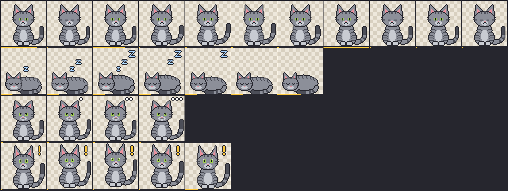

# Sprite pack format

A sprite pack is the art for the buddy: one animation per cat state. Packs can be
swapped without code changes (spec section 5). This document is the contract
between pack authors, the generator in `tools/`, and the loader and renderer.

## Folder layout

A pack is a folder containing `pack.json` and one PNG per state:

```
my-pack/
  pack.json
  idle.png
  sleeping.png
  thinking.png
  alert.png
```

File names are free (they are declared in `pack.json`), but must be plain file
names in the pack folder: no directories, no `..`. Other files in the folder
(for example `preview.png` or a README) are ignored by the app.

## `pack.json`

```json
{
  "$schema": "../pack.schema.json",
  "format": 2,
  "name": "Gray Tabby (placeholder)",
  "author": "AIchemist Desktop Buddy contributors",
  "license": "MIT",
  "frameSize": { "width": 48, "height": 48 },
  "states": {
    "idle":     { "file": "idle.png",     "frames": 4, "fps": 0,
                  "durations": [4000, 150, 3000, 150], "loop": true },
    "sleeping": { "file": "sleeping.png", "frames": 4, "fps": 0,
                  "durations": [1300, 1300, 1300, 2600], "loop": true },
    "thinking": { "file": "thinking.png", "frames": 4, "fps": 4, "loop": true },
    "alert":    { "file": "alert.png",    "frames": 6, "fps": 8, "loop": true }
  }
}
```

States can mix both timings: `thinking` and `alert` above use a fixed `fps`,
`idle` and `sleeping` use per-frame `durations` (format 2) to hold a pose for
seconds and change only briefly.

| Field | Type | Meaning |
|---|---|---|
| `$schema` | string, optional | Editor hint only. Ignored by the app. |
| `format` | `1` or `2` | Format version. `2` adds `durations`. Format 1 packs stay valid and play exactly as before. |
| `name` | string, 1-64 chars | Shown in Settings, Appearance. |
| `author` | string, 1-200 chars | Shown in Settings, Appearance. |
| `license` | string, 1-100 chars | License of the art, preferably an SPDX id (`MIT`, `CC-BY-4.0`). |
| `frameSize.width`, `frameSize.height` | integer, 8-256 | Size of one frame in pixels. Shared by all states. |
| `states.<state>.file` | string | PNG file name in the pack folder, ending in `.png`. |
| `states.<state>.frames` | integer, 1-64 | Number of frames in the strip. |
| `states.<state>.fps` | integer, 0-12 | Playback rate. `0` means a static frame (unless `durations` is given). Ignored when `durations` is given; write `0` then. |
| `states.<state>.durations` | array of integers, 50-30000, optional, format 2 only | How long each frame is shown, in milliseconds. One entry per frame (length = `frames`). Replaces `fps`. |
| `states.<state>.loop` | boolean | `true`: repeat forever. `false`: play once, then hold the last frame. |

The machine-readable version is the JSON Schema at
[`assets/sprites/pack.schema.json`](../assets/sprites/pack.schema.json)
(draft 2020-12). Unknown properties are rejected so typos are caught.

## Images

- PNG, any colour type, with alpha for transparency. Indexed PNG is recommended
  for pixel art (small files).
- **Frames are laid out horizontally in a single row**, left to right, starting
  at x = 0, with no padding or gaps. Frame `i` is the rectangle
  `x = i * frameSize.width`, `y = 0`, size `frameSize.width x frameSize.height`.
- The image is exactly `frameSize.width * frames` pixels wide and
  `frameSize.height` pixels high.
- Draw at native pixel size. The renderer scales up with nearest-neighbour
  filtering (spec section 5), so do not pre-scale or anti-alias edges.
- Keep the cat's feet on the same baseline in every state so state changes do
  not make it jump.

## Validation rules

A pack is valid when all of these hold. Invalid packs are not offered in
Settings; if the selected pack becomes invalid, the app falls back to the
bundled default.

1. `pack.json` is valid JSON and matches `pack.schema.json`. In particular:
   - all four states (`idle`, `sleeping`, `thinking`, `alert`) are present, and no others;
   - `frames >= 1`;
   - `fps` is an integer, either `0` or `1`-`12`;
   - `format` is `1` or `2`;
   - each `durations` entry is an integer from 50 to 30000 (ms).
2. `durations` is used only with `"format": 2` and has exactly `frames`
   entries (checked by `check-sprites.mjs`; the schema cannot express it).
3. Every state's `file` exists in the pack folder and is a PNG.
4. Each PNG is `frameSize.width * frames` wide and `frameSize.height` high.

Check a pack with:

```
npm run check:sprites                        # the bundled default pack (and the chime)
node tools/check-sprites.mjs path/to/my-pack # any other pack folder
```

CI runs `npm run check:sprites` on every PR.

## Playback semantics

- A state is **static** when `frames` is `1`, or when it has no `durations`
  and `fps` is `0`. The renderer draws frame 0 once and schedules nothing
  (spec section 5).
- With `durations`, frame `n` is shown for `durations[n]` milliseconds.
  Without it, every frame is shown for `1 / fps` seconds.
- `loop: true`: after the last frame the animation wraps to frame 0, so one
  cycle lasts the sum of all durations. `loop: false`: it plays once and holds
  the last frame forever; the last frame's own duration is then ignored (any
  valid value works) and nothing more is scheduled.
- Entering a state restarts its animation at frame 0.
- Each frame change costs a few ms of CPU in the webview (docs/perf.md), so
  the cost grows with frame changes per second, not with how long the
  animation is. The renderer keeps exactly one timer pending, set to the next
  frame change, and draws only when the frame changes; nothing is scheduled
  while a frame is held for good or the window is hidden.
- **Authoring tip:** for the calm states (`idle`, `sleeping`) hold a pose for
  seconds and change briefly (a blink of ~150 ms, a tail swish of a few
  ~150 ms frames). Two equal neighbouring frames are allowed but are a
  wasted redraw; merge them into one longer duration. Keep `fps` (12 at most)
  for short-lived, lively states.

### Default pack timing

| State | Frames | Timing | Frame changes per second |
|---|---|---|---|
| `idle` | 11 | sit 4 s, blink, sit 3.5 s, tail swish (4 x 150 ms), sit 5 s, double blink; 13.8 s cycle | 0.8 |
| `sleeping` | 7 | breathing out / in, each held ~2.6 s; a "z" rises every 1.3 s, then a pause; 10.4 s cycle | 0.67 |
| `thinking` | 4 | 4 fps (only during a sync) | 4 |
| `alert` | 5 | quick hop (4 frames, ~100 ms), hold 1.4 s | 2.6 |

## Pack discovery (proposal)

The loader and the Settings, Appearance selector are later tasks. Proposed
behaviour:

- **Bundled default:** `assets/sprites/default/` is shipped as a Tauri
  resource. Its id is `default`. It is always available and is the fallback.
- **User packs:** each subfolder of `<app data dir>/sprite-packs/` that contains
  a `pack.json` is a pack, where `<app data dir>` is Tauri's `app_data_dir()`
  (Windows: `%APPDATA%\<bundle id>`, macOS:
  `~/Library/Application Support/<bundle id>`). The pack id is the folder
  name. A user pack named `default` is ignored so the bundled pack cannot be
  shadowed.
- Packs are scanned when the Settings window opens (not continuously). Each is
  validated with the rules above; invalid ones are skipped and logged with the
  reason.
- The selected pack id is stored in the settings file. Settings shows `name`,
  `author` and `license` for each pack.

## Placeholder pack and chime

- The default pack is generated by `tools/gen-sprites.mjs`
  (`npm run gen:sprites`): a gray tabby cat, 48x48 frames. The generator also
  writes `assets/sprites/default/preview.png`, every frame scaled 6x, one row
  per state, for eyeballing changes; the yellow bar under each frame shows how
  long it is held (full width = 5 s or more). Output is deterministic and committed.
- The reminder chime is **not** part of a sprite pack. It lives at
  `assets/sounds/chime.wav` (mono, 22.05 kHz, 16-bit PCM, under 1 s) and is
  generated by `tools/gen-chime.mjs` (`npm run gen:chime`).
- The tools use only Node built-ins (`zlib` for PNG compression), so there are
  no extra dependencies.


